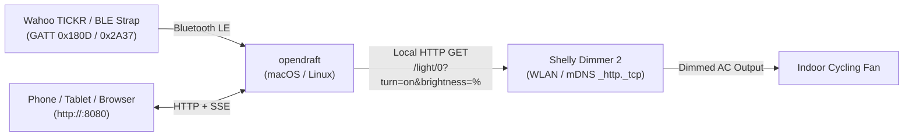

# Hardware & Network Setup Guide

> [!CAUTION]
> **DANGER TO LIFE — HIGH VOLTAGE / MAINS ELECTRICITY & NO LIABILITY**
>
> - Mains electricity (**110V–240V AC**) is **lethal**. Improper wiring can cause **fatal electric shock, severe burns, or fire**.
> - **Only a qualified, licensed electrician** may install, wire, or modify mains-powered hardware such as a Shelly Dimmer 2 or AC fan. Always switch off the circuit breaker and verify zero voltage with a proper tester before any work.
> - **Check motor compatibility:** Not all AC fans support phase-cut (trailing/leading-edge) dimming. If a fan hums, overheats, or fails to spin at low percentages, stop immediately and raise your minimum brightness or use a compatible fan.
> - **NO LIABILITY:** The authors and contributors provide this documentation **"AS IS"** with **no warranty and zero liability** for injury, death, or damage of any kind.

---

## How Our Setup Works



1. **Heart Rate Source:** A Wahoo TICKR / TICKR FIT (or any standard BLE Heart Rate strap) broadcasts live BPM over Bluetooth Low Energy (`0x180D` / `0x2A37`).
2. **Controller (`opendraft`):** Runs in your terminal on macOS or Linux, maps your BPM to a target fan percentage (`0–100%`), rate-limits updates (`500ms` / `2%` change threshold), and serves the local WebUI on `:8080` (IPv4).
3. **Fan Dimmer (`Shelly Dimmer 2`):** Sits on your local Wi-Fi network, advertises itself via mDNS (`_http._tcp`), and accepts unencrypted local HTTP requests—no cloud, no account, and no encryption keys needed.
4. **Local WebUI:** Open the `WebUI` URL printed in the TUI (e.g. `http://192.168.193.188:8080`) from your computer, phone, or tablet on the same Wi-Fi network to monitor fan speed and HR or adjust controls.

---

## Hardware & Software Checklist

1. **BLE Heart Rate Monitor** (e.g., Wahoo TICKR / TICKR FIT)
   - Make sure the strap is awake/worn so it actively advertises BLE (`0x180D`).
   - On **macOS**, grant **Bluetooth** permission to your terminal app under *System Settings → Privacy & Security → Bluetooth*.
2. **Shelly Dimmer 2** (connected to your Wi-Fi network)
   - Wired safely by a qualified electrician between mains power and a dimmer-compatible fan.
   - Configured on your local Wi-Fi network (and reachable on port `80` from the computer running `opendraft`).
   - **Important — Minimum Brightness / Starting Torque:** Many AC fans will not start spinning at `5%`–`15%`. Test with `+` in `MANUAL` mode (or in the Shelly web UI) to find the lowest percentage where your fan reliably starts spinning, and set **Entry Fan %** (`c` on the Dashboard) to at least that value (default is `15%`).
3. **Network / mDNS**
   - Your computer and Shelly Dimmer 2 should be reachable over LAN/WLAN (ideally on the same subnet so mDNS `_http._tcp` discovers it automatically).
   - On **macOS**, allow **Local Network** access for your terminal app if prompted.

---

## First-Time Run

1. Start `opendraft`:
   ```sh
   go run ./cmd/opendraft
   ```
2. In the **Discovery** screen:
   - Wait for your BLE HR monitor (e.g. `TICKR FIT 4C31`) and `shellydimmer2-...` to appear.
   - Select your HR monitor and press `Enter` to connect.
   - Press `Tab` to switch to the **Shelly Dimmers** pane, select your dimmer, and press `Enter`.
3. On the **Dashboard**:
   - Confirm your live BPM is updating.
   - Press `c` if you want to customize **Entry BPM** (default `120`), **Entry Fan %** (default `15%`), **Max BPM** (default `165`), or **Max Fan %** (default `100%`).
   - Press `Space` or `Enter` on **`▶ START FAN`** to turn the Shelly on and begin HR-driven fan control.
4. On future runs, `opendraft` loads your saved devices from `~/.config/opendraft/config.json`, opens directly on the Dashboard, and reconnects to your HR monitor automatically.

---

## Troubleshooting

- **Devices not appearing in Discovery:**
  Run `go run ./cmd/opendraft --debug-scan` to print raw BLE advertisements and mDNS `_http._tcp` / `_shelly._tcp` responses.
- **BLE strap connects but no BPM:**
  Run `go run ./cmd/opendraft --debug-hr` while wearing the strap to verify raw `0x2A37` notifications.
- **Shelly turns on (`ison: true`) but fan doesn't spin:**
  Raise **Entry Fan %** (`c` on the Dashboard) above the motor's starting threshold (e.g. `25%`–`35%`).
- **Testing without hardware:**
  Run `go run ./cmd/opendraft --mock` (or `go run ./cmd/opendraft --mock --headless` for WebUI-only mode).
- **Phone/tablet cannot reach the WebUI (`http://<lan-ip>:8080`):**
  Ensure your terminal app has **Local Network** permission under *System Settings → Privacy & Security → Local Network* on macOS, use explicit `http://` (not `https://`), and confirm your Wi-Fi router does not have client/AP isolation enabled.
